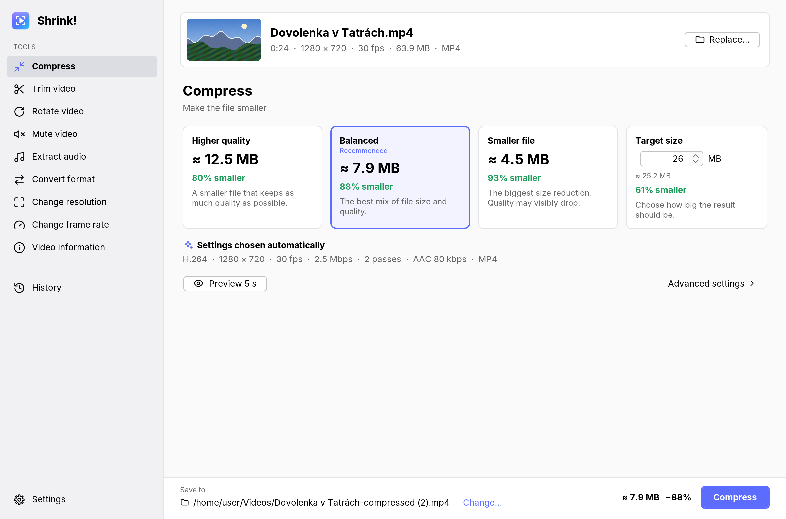
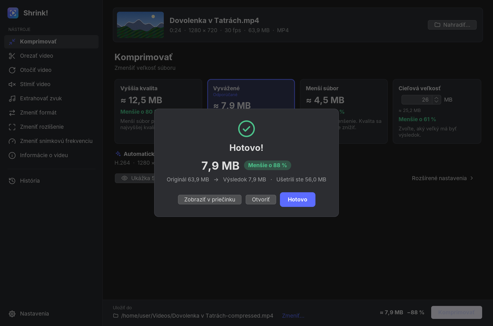
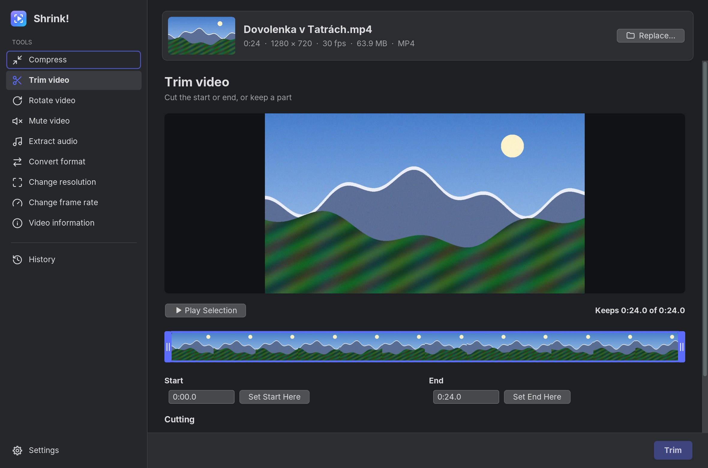

# Shrink!

**English** · [Slovensky](README.sk.md)

Shrink! makes videos smaller, converts them to other formats and does quick
edits. It runs on **Linux**, **macOS** (Intel and Apple Silicon, macOS 12
Monterey or newer) and **Android** (10 or newer), in **English** and **Slovak**.



## What it can do

| Tool | What it does |
| --- | --- |
| **Compress** | Makes the file smaller. Choose **Higher quality**, **Balanced** (recommended), **Smaller file**, or a **Target size** in MB. Each card shows the estimated size and how much smaller it will be *before* you start. |
| **Preview 5 s** | Encodes a 5-second excerpt with the chosen settings and plays it next to the original, with a slider to compare them. |
| **Trim video** | Keeps only the part you select. Drag the handles on the timeline or type the times. |
| **Rotate video** | Turns the video by 90°, 180° or 270°. When possible this is instant and lossless (no re-encoding). |
| **Mute video** | Removes the sound. The picture is copied, not re-encoded. |
| **Extract audio** | Saves the soundtrack as **M4A** or **MP3**. |
| **Convert format** | **MP4**, **MOV**, **MKV** or **WEBM**. Streams are copied without loss when the new format allows it. |
| **Change resolution** | For example 4K → 1080p, or any other size. |
| **Change frame rate** | For example 60 → 30 fps. |
| **Video information** | Format, codecs, bitrates, resolution, frame rate, HDR, audio tracks, subtitles and more. |

Also included: a **History** tab with earlier results, **Settings** (the gear
icon), light and dark themes that follow the system, drag and drop, "Open with
Shrink!" from the file manager, and **Advanced settings** for codec, bitrate,
quality (CRF), resolution, frame rate and audio. You never *need* to touch
those: the automatic settings are chosen from the video itself.

| | |
| --- | --- |
|  |  |

### Hardware acceleration

* **Desktop:** when Shrink! starts, it checks which hardware video encoders
  really work on your computer by encoding a tiny test clip: **VideoToolbox**
  on Macs, **NVIDIA NVENC**, **Intel Quick Sync** and **AMD AMF** on Linux and
  Windows. If one works for the chosen codec, it is used. If a hardware encode
  fails for any reason, Shrink! automatically redoes the job in software. On
  Macs, decoding also uses VideoToolbox.
  * On a **MacBook Air 2017** (Intel Broadwell), H.264 is encoded in hardware.
    Its chip cannot encode HEVC (H.265) in hardware, so for HEVC Shrink! uses
    the software encoder automatically.
  * Hardware encoders are much faster, but at the same size they look slightly
    worse than the software encoder. You can turn them off in **Settings →
    Use the hardware encoder when available**.
* **Android:** video is always encoded with the phone's hardware encoders
  (MediaCodec via AndroidX Media3). MP3 is encoded in software.

## Download and install

Ready-made packages are on the
[Releases page](https://github.com/m1omg/ScvrkniSa/releases) once a version is
published. The newest test builds are also attached to each run on the
[Actions page](https://github.com/m1omg/ScvrkniSa/actions) (under
"Artifacts"; you need to be signed in to GitHub).

| System | File |
| --- | --- |
| macOS, Intel (e.g. MacBook Air 2017) | `Shrink-…-macos-intel.dmg` |
| macOS, Apple Silicon (M1 and newer) | `Shrink-…-macos-apple-silicon.dmg` |
| Ubuntu, Debian, Linux Mint, Pop!_OS… | `Shrink-…-linux-amd64.deb` |
| Fedora, openSUSE… | `Shrink-…-linux-x86_64.rpm` |
| Any 64-bit Linux | `Shrink-…-linux-x86_64.tar.gz` (unpack, run `Shrink/bin/Shrink`) |
| Android 10+ | `Shrink-…-android.apk` |
| Windows (bonus, not tested) | `Shrink-…-windows-x64.zip` (unpack, run `Shrink.exe`) |

Everything is included: Shrink! brings its own Java runtime and its own FFmpeg,
so there is nothing else to install.

### macOS: the first start

Shrink! is not signed with a paid Apple Developer ID, so macOS blocks it the
first time. Open the DMG, drag **Shrink!** into **Applications**, and then:

* **macOS 12–14:** right-click (or Control-click) **Shrink!** in Applications,
  choose **Open**, then **Open** again. This is needed only once.
* **macOS 15 and newer:** try to open it once, then go to **System Settings →
  Privacy & Security** and click **Open Anyway**.
* Or, in Terminal (works on every version):

  ```sh
  xattr -dr com.apple.quarantine "/Applications/Shrink!.app"
  ```

### Linux

```sh
sudo apt install ./Shrink-*-linux-amd64.deb     # Ubuntu, Debian, Mint
sudo dnf install ./Shrink-*-linux-x86_64.rpm    # Fedora
```

Shrink! then appears in your applications menu.

### Android

Download the APK on the phone and open it. Android asks you to allow installing
apps from your browser or file manager; allow it once. Results are saved in
**Movies/Shrink** (videos) and **Music/Shrink** (audio); in the settings you can
switch to choosing the place every time.

## Using Shrink!

1. Open a video: click **Choose Video…**, drag a file onto the window, or use
   "Open with → Shrink!" in your file manager. On Android, tap the big button or
   share a video to Shrink! from another app.
2. Pick a tool on the left (on Android: on the home screen).
3. The bar at the bottom shows the estimated result and where it will be saved.
   Press the main button (**Compress**, **Trim**, …).
4. When it is done you can open the result, show it in its folder, or share it
   (Android). Every result is listed in **History**.

The original file is never changed. By default the result is saved next to it,
with a suffix such as `-compressed`, and an existing file is never overwritten.

**About the estimates:** sizes are calculated before encoding from the
resolution, frame rate, length and codec, so they are estimates, but usually
close. **Target size** aims slightly below the size you ask for. On the
desktop, the software encoder makes two passes to hit it accurately; with a
hardware encoder, Shrink! leaves a slightly bigger safety margin instead. If an
encoder (usually a hardware one) still overshoots the estimate by more than
15 %, Shrink! automatically encodes once more at a lower bitrate and keeps the
smaller file.

## Building it yourself

You need **JDK 21**. The first build downloads its dependencies.

```sh
./gradlew :desktop:run                        # start the desktop app
./gradlew -Pshrink.android=false test         # run the tests
./gradlew :desktop:jpackage                   # build a package for this OS (DMG, deb/rpm, …)
./gradlew :android:assembleRelease            # Android APK (needs the Android SDK)
```

* The Android module is built only when an Android SDK is found
  (`ANDROID_HOME` or `local.properties`); `-Pshrink.android=true/false` forces it.
* FFmpeg for the desktop comes from the
  [bytedeco FFmpeg builds](https://github.com/bytedeco/javacpp-presets/tree/master/ffmpeg)
  (FFmpeg 7.1). Version `7.1-1.5.11` is used on purpose: it is the newest one
  whose Mac programs still run on macOS 12 Monterey. Add
  `-Pshrink.bundleFfmpeg=false` to leave it out and use the FFmpeg installed on
  the system instead.
* Pushing a tag such as `v1.0.0` makes GitHub Actions build all packages and
  publish a release.
* Android release signing: without configuration, the APK is signed with the
  public key in `android/debug.keystore`, so new builds install over old ones.
  For your own private key, add the repository secrets
  `SHRINK_KEYSTORE_BASE64` (the keystore file, base64-encoded),
  `SHRINK_KEYSTORE_PASSWORD`, `SHRINK_KEY_ALIAS` and `SHRINK_KEY_PASSWORD`.
  Switching keys requires uninstalling the old app once.

### Tests

* `core`: the planner, size estimates, number formatting in both languages, and
  the Matroska/WebM writer (checked with FFmpeg when it is installed).
* `desktop`: runs every tool with FFmpeg on generated videos, including HDR
  tone mapping, rotation, previews and cancelling; the hardware-encoder
  commands and the software fallback are unit-tested.
* `android`: instrumented tests run in CI on an Android emulator. They go
  through the screens like a person would, and they run every tool and check
  the results with Android's own media parsers.

## How the code is organised

The project is plain Java, split into three Gradle modules:

| Module | Contents |
| --- | --- |
| `core/` | Shared by desktop and Android. Java 17, no dependencies. `model/` (records and enums such as `Job`, `MediaInfo`, `Container`), `plan/` (`JobPlanner` decides *how* to encode: codec, bitrate, resolution; `QualityModel` and `SizeEstimator` predict the size), `i18n/` (texts and Slovak/English number formats), `store/` (settings and history as JSON), `mkv/` (a small Matroska/WebM writer). |
| `desktop/` | Java 21 + Swing with [FlatLaf](https://www.formdev.com/flatlaf/). `engine/` turns a `Job` into FFmpeg commands (`CommandBuilder`), runs them (`Engine`, `FfmpegRunner`) and reads the progress; `ui/` holds the window, the tool panels and the video player. |
| `android/` | Java + [AndroidX Media3 Transformer](https://developer.android.com/media/media3/transformer) for hardware encoding; `ui/` has the glass-style screens. |

If you are learning Java, good places to start are
`core/.../model/Job.java` (an immutable class with a builder),
`core/.../plan/JobPlanner.java` (the decisions behind the automatic settings),
`desktop/.../engine/CommandBuilder.java` (how a job becomes an FFmpeg command)
and `desktop/.../ui/tools/CompressPanel.java` (a Swing screen). All texts are in
`core/src/main/resources/io/github/m1omg/shrink/i18n/messages*.properties`;
the Android string resources are generated from them during the build.

Animations and video playback are driven by elapsed time, not by counting
frames, so they run at the same speed on 60 Hz, 120 Hz or any other display.

## License

Shrink! is free software under the [GNU General Public License v3](LICENSE).

It uses:

* [FFmpeg](https://ffmpeg.org/) (desktop), a GPL build that includes x264 and
  x265 (GPL);
* [FlatLaf](https://www.formdev.com/flatlaf/) (Apache License 2.0) and
  [JSVG](https://github.com/weisJ/jsvg) (MIT), desktop;
* [AndroidX](https://developer.android.com/jetpack/androidx), Media3 and
  Material Components (Apache License 2.0), Android;
* [jump3r](https://central.sonatype.com/artifact/de.sciss/jump3r), a Java port
  of LAME (LGPL 2.1 or later), for MP3 on Android.
