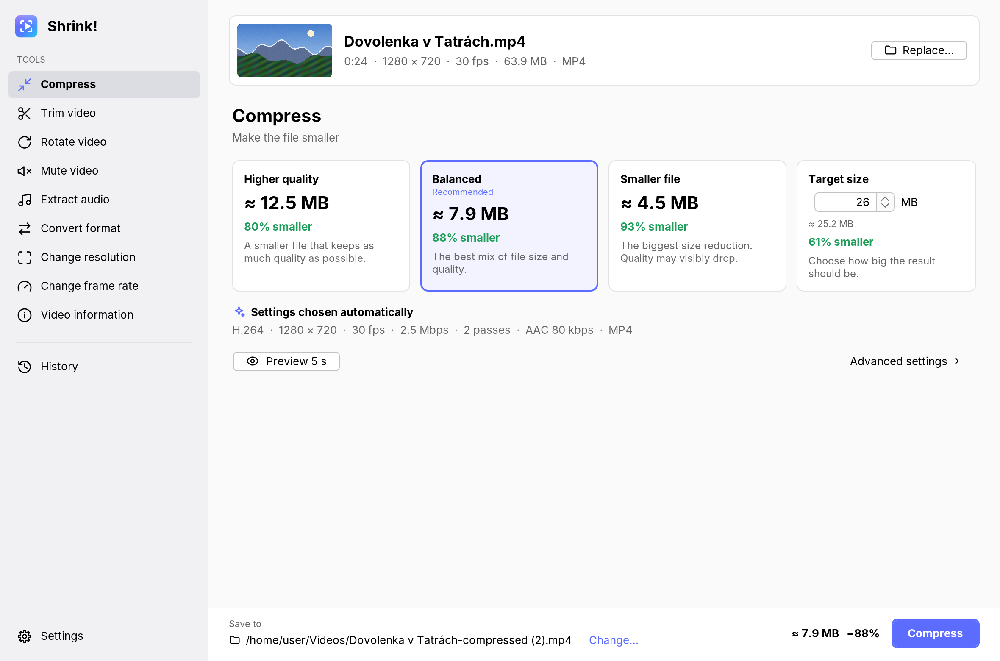
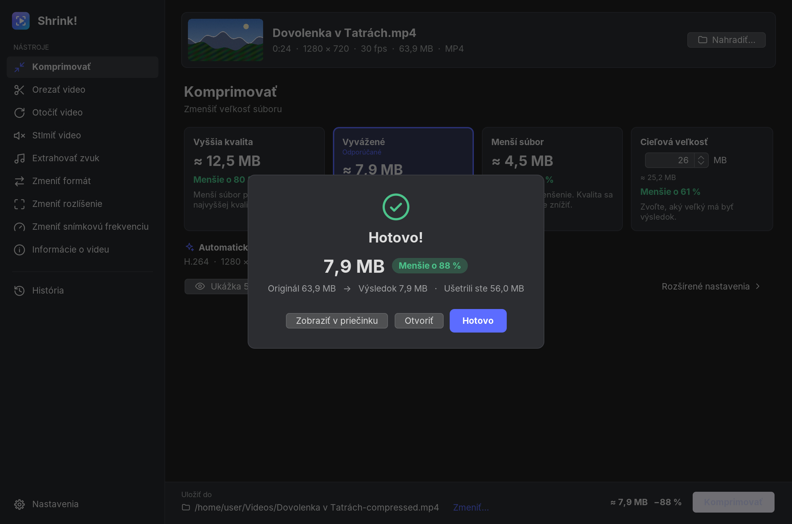
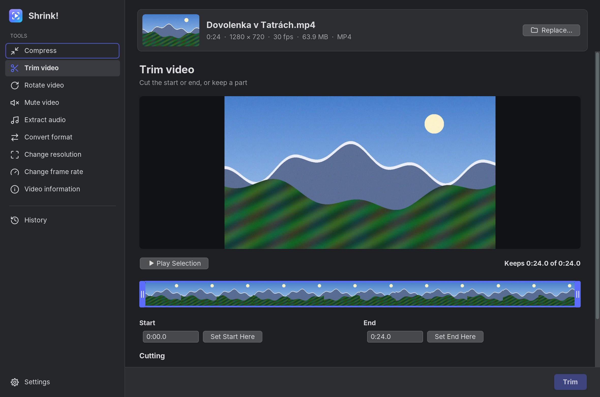

# Shrink!

[English](README.md) · **Slovensky**

Shrink! zmenšuje videá, prevádza ich do iných formátov a robí rýchle úpravy.
Funguje na **Linuxe**, **macOS** (Intel aj Apple Silicon, macOS 12 Monterey
alebo novší), **Windows 10 a 11** a **Androide** (10 alebo novší), po
**slovensky** aj **anglicky**. Všetko potrebné je súčasťou aplikácie: netreba
inštalovať Javu, FFmpeg ani balíky kodekov.



## Čo dokáže

| Nástroj | Čo robí |
| --- | --- |
| **Komprimovať** | Zmenší súbor. Vyberte **Vyššia kvalita**, **Vyvážené** (odporúčané), **Menší súbor** alebo **Cieľová veľkosť** v MB. Každá karta ukáže odhadovanú veľkosť a o koľko bude súbor menší ešte *predtým*, ako začnete. |
| **Ukážka 5 s** | Zakóduje 5-sekundový úsek so zvolenými nastaveniami a prehrá ho vedľa originálu s posuvníkom na porovnanie. |
| **Orezať video** | Ponechá iba vybranú časť. Potiahnite úchyty na časovej osi alebo zadajte časy. |
| **Otočiť video** | Otočí video o 90°, 180° alebo 270°. Keď sa dá, je to okamžité a bez straty kvality (bez prekódovania). |
| **Stlmiť video** | Odstráni zvuk. Obraz sa skopíruje, neprekóduje sa. |
| **Extrahovať zvuk** | Uloží zvukovú stopu ako **M4A** alebo **MP3**. |
| **Zmeniť formát** | **MP4**, **MOV**, **MKV** alebo **WEBM**. Ak to nový formát dovoľuje, stopy sa skopírujú bez straty. |
| **Zmeniť rozlíšenie** | Napríklad 4K → 1080p alebo ľubovoľná iná veľkosť. |
| **Zmeniť snímkovú frekvenciu** | Napríklad 60 → 30 snímok za sekundu. |
| **Informácie o videu** | Formát, kodeky, dátové toky, rozlíšenie, snímková frekvencia, dynamický rozsah (HDR), zvukové stopy, titulky a ďalšie. |

Ďalej: karta **História** s predchádzajúcimi výsledkami, **Nastavenia** (ikona
ozubeného kolieska), svetlý a tmavý vzhľad podľa systému, presúvanie súborov
myšou, „Otvoriť v aplikácii Shrink!“ zo správcu súborov a **Rozšírené
nastavenia** pre kodek, dátový tok, kvalitu (CRF), rozlíšenie, snímkovú
frekvenciu a zvuk. Tie nikdy *nemusíte* použiť: automatické nastavenia sa
vyberú podľa samotného videa.

| | |
| --- | --- |
|  |  |

### Hardvérová akcelerácia

* **Počítač:** pri spustení Shrink! zistí, ktoré hardvérové kodéry videa na
  vašom počítači naozaj fungujú, tak, že zakóduje malý skúšobný klip:
  **VideoToolbox** na Macoch, **NVIDIA NVENC**, **Intel Quick Sync** a **AMD
  AMF** na Linuxe a Windows. Ak niektorý funguje pre zvolený kodek, použije sa.
  Ak hardvérové kódovanie z akéhokoľvek dôvodu zlyhá, Shrink! úlohu
  automaticky zopakuje softvérovo. Na Macoch sa cez VideoToolbox aj dekóduje.
  * Na **MacBooku Air 2017** (Intel Broadwell) sa H.264 kóduje hardvérovo. Jeho
    čip nevie hardvérovo kódovať HEVC (H.265), preto pre HEVC Shrink!
    automaticky použije softvérový kodér.
  * Hardvérové kodéry sú oveľa rýchlejšie, no pri rovnakej veľkosti vyzerá
    výsledok o niečo horšie ako zo softvérového kodéra. Vypnúť ich môžete v
    **Nastavenia → Použiť hardvérový kodér, ak je k dispozícii**.
* **Android:** video sa vždy kóduje hardvérovými kodérmi telefónu (MediaCodec
  cez AndroidX Media3). MP3 sa kóduje softvérovo.

## Stiahnutie a inštalácia

Hotové balíky nájdete na stránke
[Releases](https://github.com/m1omg/ScvrkniSa/releases), keď bude zverejnená
verzia. Najnovšie skúšobné zostavenia sú priložené pri každom behu na stránke
[Actions](https://github.com/m1omg/ScvrkniSa/actions) (v časti „Artifacts“;
treba byť prihlásený na GitHube).

| Systém | Súbor |
| --- | --- |
| macOS, Intel (napr. MacBook Air 2017) | `Shrink-…-macos-intel.dmg` |
| macOS, Apple Silicon (M1 a novšie) | `Shrink-…-macos-apple-silicon.dmg` |
| Ubuntu, Debian, Linux Mint, Pop!_OS… | `Shrink-…-linux-amd64.deb` |
| Fedora, openSUSE… | `Shrink-…-linux-x86_64.rpm` |
| Akýkoľvek 64-bitový Linux | `Shrink-…-linux-x86_64.tar.gz` (rozbaľte a spustite `Shrink/bin/Shrink`) |
| Windows 10 a 11 (64-bitové) | `Shrink-…-windows-x64.msi` (inštalátor) alebo `Shrink-…-windows-x64.zip` (prenosná verzia: rozbaľte a spustite `Shrink.exe`) |
| Android 10+ | `Shrink-…-android.apk` |

Všetko potrebné je súčasťou balíka: Shrink! má vlastné prostredie Java aj
vlastný FFmpeg, takže netreba nič ďalšie inštalovať a funguje aj bez
internetu. Balíky pre Linux potrebujú distribúciu z roku 2019 alebo novšiu
(glibc 2.29: Ubuntu 20.04, Debian 11, Fedora 30, Linux Mint 20 alebo novšie).

### macOS: prvé spustenie

Shrink! nie je podpísaný platenou identitou Apple Developer ID, preto ho macOS
pri prvom spustení zablokuje. Otvorte DMG, presuňte **Shrink!** do priečinka
**Aplikácie** a potom:

* **macOS 12–14:** kliknite na **Shrink!** v Aplikáciách pravým tlačidlom
  (alebo s klávesom Control), vyberte **Otvoriť** a potom znova **Otvoriť**.
  Stačí to urobiť raz.
* **macOS 15 a novší:** skúste aplikáciu raz otvoriť, potom choďte do
  **Systémové nastavenia → Súkromie a bezpečnosť** a kliknite na tlačidlo,
  ktoré ju napriek tomu otvorí (v angličtine „Open Anyway“).
* Alebo v Termináli (funguje na každej verzii):

  ```sh
  xattr -dr com.apple.quarantine "/Applications/Shrink!.app"
  ```

### Windows

Spustite inštalátor `.msi`. Nainštaluje Shrink! iba pre váš používateľský účet,
takže nepotrebuje práva správcu, a pridá ho do ponuky Štart. Shrink! nie je
podpísaný plateným certifikátom, preto môže Windows SmartScreen zobraziť
modré upozornenie: kliknite na odkaz s ďalšími informáciami a potom na
tlačidlo, ktoré aplikáciu aj tak spustí (v angličtine „More info“ a „Run
anyway“). Prenosná verzia `.zip` sa vôbec neinštaluje.

### Linux

```sh
sudo apt install ./Shrink-*-linux-amd64.deb     # Ubuntu, Debian, Mint
sudo dnf install ./Shrink-*-linux-x86_64.rpm    # Fedora
```

Shrink! sa potom objaví v ponuke aplikácií.

### Android

Stiahnite APK v telefóne a otvorte ho. Android vás požiada o povolenie
inštalovať aplikácie z prehliadača alebo správcu súborov; povoľte to raz.
Výsledky sa ukladajú do **Movies/Shrink** (videá) a **Music/Shrink** (zvuk);
v nastaveniach môžete zapnúť, aby sa aplikácia zakaždým spýtala, kam uložiť.

## Ako používať Shrink!

1. Otvorte video: kliknite na **Vybrať video…**, presuňte súbor do okna alebo
   použite „Otvoriť v aplikácii → Shrink!“ v správcovi súborov. Na Androide
   ťuknite na veľké tlačidlo alebo video do Shrink! zdieľajte z inej aplikácie.
2. Vyberte nástroj vľavo (na Androide na domovskej obrazovke).
3. Lišta dole ukazuje odhadovaný výsledok a kam sa uloží. Stlačte hlavné
   tlačidlo (**Komprimovať**, **Orezať**, …).
4. Po dokončení môžete výsledok otvoriť, zobraziť v priečinku alebo zdieľať
   (Android). Každý výsledok nájdete v **Histórii**.

Pôvodný súbor sa nikdy nemení. Výsledok sa predvolene uloží vedľa neho s
príponou v názve, napríklad `-compressed`, a existujúci súbor sa nikdy
neprepíše.

**O odhadoch:** veľkosti sa počítajú pred kódovaním z rozlíšenia, snímkovej
frekvencie, dĺžky a kodeku, takže sú to odhady, no zvyčajne presné.
**Cieľová veľkosť** mieri o trochu nižšie, ako zadáte. Na počítači softvérový
kodér prejde video dvakrát, aby veľkosť presne trafil; s hardvérovým kodérom
si Shrink! namiesto toho nechá o niečo väčšiu rezervu. Ak kodér (zvyčajne
hardvérový) aj tak prekročí odhad o viac ako 15 %, Shrink! video automaticky
zakóduje ešte raz s nižším dátovým tokom a ponechá menší súbor.

## Zostavenie zo zdrojového kódu

Potrebujete **JDK 21**. Prvé zostavenie stiahne potrebné knižnice.

```sh
./gradlew :desktop:run                        # spustí aplikáciu pre počítač
./gradlew -Pshrink.android=false test         # spustí testy
./gradlew :desktop:jpackage                   # balík pre tento systém (DMG, deb/rpm, …)
./gradlew :android:assembleRelease            # APK pre Android (treba Android SDK)
```

* Modul pre Android sa zostaví, len ak sa nájde Android SDK (`ANDROID_HOME`
  alebo `local.properties`); `-Pshrink.android=true/false` to vynúti.
* FFmpeg pre počítač pochádza zo
  [zostavení FFmpeg od bytedeco](https://github.com/bytedeco/javacpp-presets/tree/master/ffmpeg)
  (FFmpeg 7.1). Verzia `7.1-1.5.11` je zvolená zámerne: je to najnovšia, ktorej
  programy pre Mac ešte fungujú na macOS 12 Monterey. S
  `-Pshrink.bundleFfmpeg=false` sa nepribalí a použije sa FFmpeg nainštalovaný
  v systéme.
* Po odoslaní značky (tagu) ako `v1.0.0` GitHub Actions zostaví všetky balíky a
  zverejní vydanie.
* Podpisovanie APK: bez nastavenia sa APK podpíše verejným kľúčom v
  `android/debug.keystore`, takže nové zostavenia sa nainštalujú cez staré. Pre
  vlastný súkromný kľúč pridajte do repozitára tajomstvá (secrets)
  `SHRINK_KEYSTORE_BASE64` (súbor s kľúčmi v base64),
  `SHRINK_KEYSTORE_PASSWORD`, `SHRINK_KEY_ALIAS` a `SHRINK_KEY_PASSWORD`. Pri
  zmene kľúča treba starú aplikáciu raz odinštalovať.

### Testy

* `core`: plánovač, odhady veľkosti, formátovanie čísel v oboch jazykoch a
  zapisovač Matroska/WebM (overený pomocou FFmpeg, ak je nainštalovaný).
* `desktop`: spustí každý nástroj s FFmpeg na vygenerovaných videách vrátane
  prevodu HDR, otáčania, ukážok a zrušenia; príkazy pre hardvérové kodéry a
  softvérová záloha majú jednotkové testy.
* `android`: inštrumentované testy bežia v CI na emulátore Androidu. Prejdú
  obrazovkami ako človek, spustia každý nástroj a výsledky skontrolujú
  vlastnými nástrojmi Androidu na čítanie médií.

## Ako je kód usporiadaný

Projekt je čistá Java rozdelená do troch modulov Gradle:

| Modul | Obsah |
| --- | --- |
| `core/` | Spoločný pre počítač aj Android. Java 17, bez závislostí. `model/` (záznamy a enumy ako `Job`, `MediaInfo`, `Container`), `plan/` (`JobPlanner` rozhoduje, *ako* kódovať: kodek, dátový tok, rozlíšenie; `QualityModel` a `SizeEstimator` predpovedajú veľkosť), `i18n/` (texty a slovenské/anglické formáty čísel), `store/` (nastavenia a história v JSON), `mkv/` (malý zapisovač Matroska/WebM). |
| `desktop/` | Java 21 + Swing s [FlatLaf](https://www.formdev.com/flatlaf/). `engine/` premení `Job` na príkazy FFmpeg (`CommandBuilder`), spustí ich (`Engine`, `FfmpegRunner`) a číta priebeh; `ui/` obsahuje okno, panely nástrojov a prehrávač videa. |
| `android/` | Java + [AndroidX Media3 Transformer](https://developer.android.com/media/media3/transformer) na hardvérové kódovanie; `ui/` obsahuje obrazovky v štýle matného skla. |

Ak sa učíte Javu, dobré miesta na začiatok sú
`core/.../model/Job.java` (nemenná trieda s builderom),
`core/.../plan/JobPlanner.java` (rozhodnutia za automatickými nastaveniami),
`desktop/.../engine/CommandBuilder.java` (ako sa z úlohy stane príkaz FFmpeg)
a `desktop/.../ui/tools/CompressPanel.java` (obrazovka v Swingu). Všetky texty
sú v `core/src/main/resources/io/github/m1omg/shrink/i18n/messages*.properties`;
textové prostriedky pre Android sa z nich generujú počas zostavenia.

Animácie a prehrávanie videa sa riadia uplynutým časom, nie počítaním snímok,
takže bežia rovnako rýchlo na displeji s 60 Hz, 120 Hz aj akoukoľvek inou
obnovovacou frekvenciou.

## Licencia

Shrink! je slobodný softvér pod licenciou
[GNU General Public License v3](LICENSE).

Používa:

* [FFmpeg](https://ffmpeg.org/) (počítač), zostavenie pod GPL vrátane x264 a
  x265 (GPL);
* [FlatLaf](https://www.formdev.com/flatlaf/) (Apache License 2.0) a
  [JSVG](https://github.com/weisJ/jsvg) (MIT), počítač;
* [AndroidX](https://developer.android.com/jetpack/androidx), Media3 a
  Material Components (Apache License 2.0), Android;
* [jump3r](https://central.sonatype.com/artifact/de.sciss/jump3r), port LAME do
  Javy (LGPL 2.1 alebo novšia), na MP3 v Androide.
